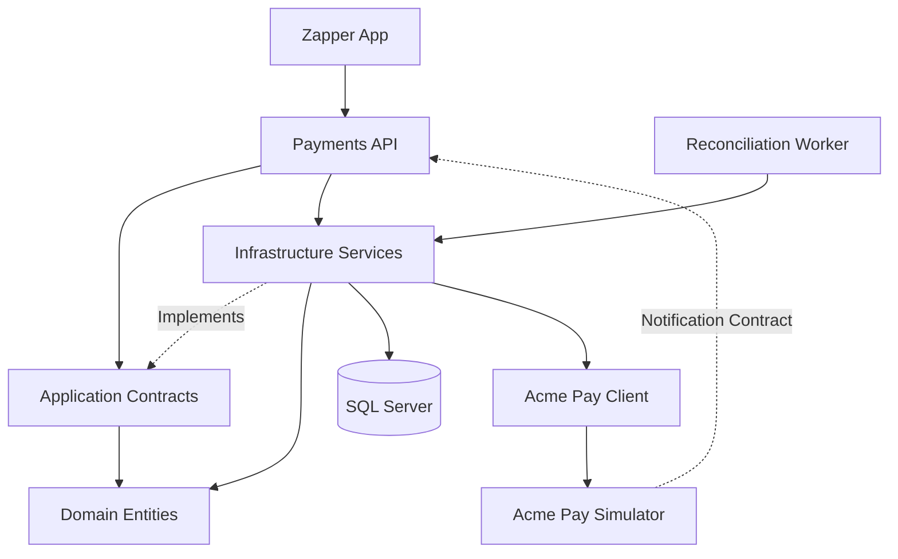
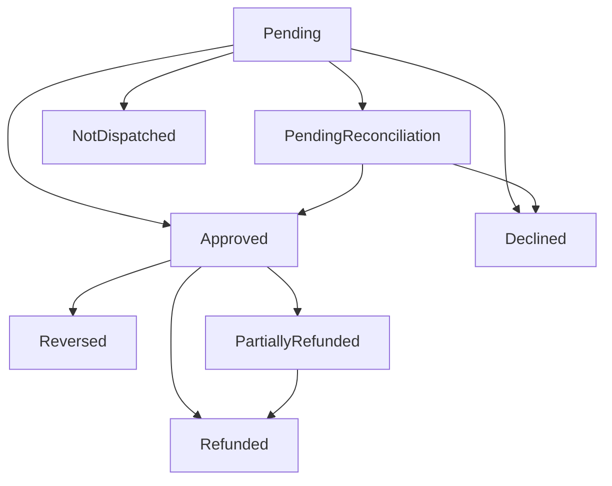

# Zapper Payments Integration Service

## Overview

This solution was developed as part of the Zapper Team Lead Software
Engineer Technical Vetting Assignment.

It demonstrates a payment integration service that allows customers
to make payments using previously stored card tokens, processes
payments through a simulated Acme Pay gateway, tracks payment
lifecycle changes and provides daily financial reporting.

The implementation focuses on payment correctness, idempotency,
resilience, notification processing, auditability and operational
readiness.

## Technology Stack

| Technology | Purpose |
|---|---|
| C# / .NET 8 | Application development |
| ASP.NET Core Web API | REST API |
| Entity Framework Core | Database access and migrations |
| SQL Server 2022 | Persistent data storage |
| Docker | Application containerisation |
| Docker Compose | Local environment orchestration |
| xUnit | Unit and integration testing |
| PowerShell | Concurrency and verification scripts |
| Swagger / OpenAPI | API documentation and testing |

## Quick Start

### Prerequisites

- Git
- Docker Desktop with Linux containers enabled
- Docker Compose
- PowerShell 7 or later for the supplied verification and concurrency scripts

The .NET 8 SDK is only required when building or testing the
solution outside Docker.

SQL Server Management Studio is optional for database inspection
and running the daily reporting query.

### 1. Clone the repository

Clone this repository using its GitHub clone URL and navigate to
the repository root.

### 2. Configure the environment


| Environment Variable | Purpose |
|---|---|
| SQL_SA_PASSWORD | Local SQL Server password |
| ACME_API_KEY | Acme Pay bearer authentication key |
| ACME_MERCHANT_ID | Acme merchant account identifier |
| ACME_ADVICE_USERNAME | Payment advice authentication username |
| ACME_ADVICE_PASSWORD | Payment advice authentication password |
| ACME_WEBHOOK_SECRET | Transaction status webhook signing secret |

The supplied `.env.example` contains synthetic local assessment
credentials and can be copied directly to `.env` to run the
solution.

Create a local environment file from the supplied example.

```powershell
Copy-Item .env.example .env
```

Review the values in `.env` before starting the containers.

The environment file provides configuration for:

- SQL Server credentials
- Acme Pay API key
- Acme Pay merchant identifier
- Payment advice authentication credentials
- Transaction status webhook signing secret

The `.env` file is excluded from source control.

Only synthetic local development credentials should be used.

### 3. Start the application

Ensure Docker Desktop is running.

From the repository root:

```powershell
docker compose up --build -d
```

Verify the containers:

```powershell
docker compose ps
```

The solution starts three containers:

| Container | Responsibility |
|---|---|
| payments-api | Payment processing and notification handling |
| acme-stub | Local Acme Pay gateway simulator |
| sqlserver | Persistent database storage |

Database migrations and synthetic seed data are applied during
application startup.

### 4. Verify application health

```powershell
Invoke-RestMethod http://localhost:8080/health

Invoke-RestMethod http://localhost:8081/health
```

Both services should return a healthy response.

### 5. Access the services

| Service | Address |
|---|---|
| Payments API | http://localhost:8080 |
| Payments API Swagger | http://localhost:8080/swagger |
| Payments API health | http://localhost:8080/health |
| Acme Pay simulator | http://localhost:8081 |
| Acme simulator Swagger | http://localhost:8081/swagger |
| Acme simulator health | http://localhost:8081/health |
| SQL Server | 127.0.0.1,14333 |

All exposed Docker ports are bound to the local loopback interface.

## Architecture

The solution follows a layered modular architecture with separation
between API, application, domain and infrastructure responsibilities.



The notification connection represents the provider callback
interface. Notification deliveries can be simulated manually for
assessment verification.

## Repository Structure

```text
Zapper_Payment/
|
|-- src/
|   |-- Zapper.Payments.Api/
|   |-- Zapper.Payments.Application/
|   |-- Zapper.Payments.Domain/
|   |-- Zapper.Payments.Infrastructure/
|   |-- Zapper.AcmePay.Stub/
|
|-- tests/
|   |-- Zapper.Payments.UnitTests/
|   |-- Zapper.Payments.IntegrationTests/
|
|-- database/
|   |-- Reporting/
|       |-- DailyPaymentSummary.sql
|
|-- scripts/
|   |-- load-testing/
|       |-- Test-PaymentConcurrency.ps1
|       |-- results/
|
|-- docker-compose.yml
|-- .dockerignore
|-- .env.example
|-- .gitignore
|-- Zapper.Payments.sln
|-- README.md
|-- SOLUTION.md
```

### Project Responsibilities

| Project | Responsibility |
|---|---|
| Payments.Api | REST endpoints, authentication and host configuration |
| Payments.Application | Interfaces, contracts, DTOs and validation |
| Payments.Domain | Payment entities, lifecycle states and domain definitions |
| Payments.Infrastructure | SQL persistence, Acme integration, business services and background reconciliation |
| AcmePay.Stub | Synthetic payment gateway and provider diagnostics |
| UnitTests | Isolated application-level tests |
| IntegrationTests | API and authentication integration tests |

## Seed Data

The application automatically creates synthetic customers,
sub-merchants and stored card records.

### Customers

| Customer Identifier | Email |
|---|---|
| CUST-1001 | alice@example.com |
| CUST-1002 | john@example.com |

### Sub-Merchants

| Merchant Identifier | Trading Name | City | MCC |
|---|---|---|---|
| ZAP0004182 | CAFE DEL SOL | CAPE TOWN | 5812 |
| ZAP0004183 | JOHNNY'S CAFE | PRETORIA | 5812 |

### Stored Card Tokens

| Customer | Token |
|---|---|
| CUST-1001 | TEST_TOKEN_ALICE_001 |
| CUST-1002 | TEST_TOKEN_JOHN_001 |

All customer information and card tokens are synthetic.

## API Endpoints

### Payment Operations

| Method | Endpoint | Purpose |
|---|---|---|
| POST | /api/payments | Submit a payment |
| GET | /api/payments/{appPaymentId} | Retrieve current payment state |
| POST | /api/payments/{appPaymentId}/reconcile | Perform manual reconciliation |

Manual reconciliation is available for development and assessment
verification.

### Diagnostics

| Method | Endpoint | Purpose |
|---|---|---|
| GET | /health | Application health |
| GET | /api/diagnostics/acme/transactions/{transactionId} | Query Acme transaction status |
| GET | /api/diagnostics/acme/authentication | Verify Basic Authentication |


### Notifications

| Method | Endpoint | Authentication |
|---|---|---|
| POST | /api/notifications/acme/payment-advice | HTTP Basic Authentication |
| POST | /api/notifications/acme/transaction-status | HMAC-SHA256 |

The notification endpoints support:

- Payment approval and decline notifications.
- Payment reversal notifications.
- Full and partial refund notifications.
- Duplicate notification detection.
- Out-of-order notification handling.
- Protection against invalid payment lifecycle transitions.

Payment advice credentials and webhook signing secrets are
provided through environment configuration.

Transaction status notifications require a Base64-encoded
HMAC-SHA256 signature of the exact request body bytes,
supplied through the `x-signature` header.

## Submit a Payment

Use the Payments API Swagger interface or PowerShell.

### Example Request

POST `/api/payments`

```json
{
  "customerId": "CUST-1001",
  "subMerchantId": "ZAP0004182",
  "amount": 1999,
  "currencyCode": "ZAR",
  "appPaymentId": "APP-DEMO-001"
}
```

Amounts are expressed in the lowest monetary unit.

For example, 1999 represents R19.99.

### PowerShell Example

```powershell
$baseUrl = "http://localhost:8080"

$appPaymentId = "APP-DEMO-" + [Guid]::NewGuid().ToString("N")

$payment = @{
    customerId    = "CUST-1001"
    subMerchantId = "ZAP0004182"
    amount        = 1999
    currencyCode  = "ZAR"
    appPaymentId  = $appPaymentId
} | ConvertTo-Json

$response = Invoke-RestMethod `
    -Uri "$baseUrl/api/payments" `
    -Method Post `
    -ContentType "application/json" `
    -Body $payment

$response | ConvertTo-Json -Depth 10
```

A successful payment returns the local payment identifier,
provider transaction identifier, order number, payment status
and Acme response information.

For an approved payment, the expected status is `Approved`
with Acme response code `00`.

### Query Payment Status

```powershell
Invoke-RestMethod `
    -Uri "$baseUrl/api/payments/$appPaymentId"
```

The query endpoint retrieves the current locally persisted
payment state.

### Duplicate Payment Verification

Submit the same request again without changing the app payment
identifier.

```powershell
Invoke-RestMethod `
    -Uri "$baseUrl/api/payments" `
    -Method Post `
    -ContentType "application/json" `
    -Body $payment
```

The original payment identifiers should be returned.

The service should not create another payment or submit another
financial transaction to Acme.

Reusing an existing app payment identifier with conflicting payment
details is rejected.

## Payment Lifecycle

The payment lifecycle supports the following states:

| State | Description |
|---|---|
| Pending | Payment registered for submission |
| Approved | Payment approved by the acquirer |
| Declined | Payment declined by the acquirer |
| PendingReconciliation | Provider outcome is not yet confirmed |
| Reversed | Previously approved payment has been reversed |
| PartiallyRefunded | Part of the authorised amount has been refunded |
| Refunded | Full refundable amount has been refunded |
| NotDispatched | Request was prevented from reaching the provider |



The diagram represents the principal payment lifecycle transitions.

## Acme Pay Simulation

The Acme Pay simulator provides predictable synthetic outcomes
for testing the integration.

The following token values can be used to exercise different
provider behaviours:

| Token | Simulated Behaviour |
|---|---|
| TEST_TOKEN_ALICE_001 | Normal approval |
| TEST_TOKEN_JOHN_001 | Normal approval |
| TEST_TOKEN_DECLINED | Acquirer decline |
| TEST_TOKEN_PROCESSING | Unresolved provider transaction |
| TEST_TOKEN_TIMEOUT | Delayed response exceeding the client timeout |

The simulator also supports provider error scenarios and
diagnostic instrumentation.

To exercise a specific token-based scenario, temporarily update
the synthetic customer's active stored card token in the local
database and submit a payment with a new app payment identifier.

Restore the original token after testing.

Use only the local assessment database for these modifications.

## Idempotency and Resilience

The integration includes:

- Persistent app payment identifiers.
- Stable provider transaction identifiers.
- Database uniqueness constraints.
- Duplicate payment detection.
- Shared outbound throttling for payment and RTTQ requests
  within an application instance.
- Bounded outbound concurrency and queueing.
- HTTP connection pooling.
- Provider timeout handling.
- HTTP 429 handling and Retry-After support.
- Safe handling of uncertain provider responses.
- Manual and automated reconciliation.
- Notification deduplication.
- Protection against conflicting lifecycle updates.

A payment with an uncertain outcome is not automatically
resubmitted under a new transaction identifier.

Instead, the original transaction is investigated using Acme's
Real-Time Transaction Query (RTTQ) interface.

## Notification Security

Payment advice notifications use HTTP Basic Authentication.

Transaction status notifications use HMAC-SHA256 signatures
calculated over the exact request body bytes and supplied in the
`x-signature` header as a Base64-encoded value.

Credentials and signing secrets are supplied through environment
configuration.

The following authentication scenarios were verified in Docker:

| Scenario | Expected | Actual |
|---|---|---|
| Valid Basic Authentication credentials | 200 | 200 |
| Missing credentials | 401 | 401 |
| Invalid credentials | 401 | 401 |

The public-facing application authentication requirements are
outside the scope of this assignment.

## Database Design

The database contains the following application tables:

| Table | Responsibility |
|---|---|
| Customers | Synthetic customer records |
| StoredCards | Customer payment tokens |
| SubMerchants | Merchant and settlement information |
| Payments | Current payment state |
| PaymentEvents | Payment lifecycle history |
| AcmeNotifications | Received notification information |
| AcmeRequestLogs | Outbound integration diagnostics |

Entity Framework Core manages the database schema and migrations.

A separate payment lifecycle history is maintained to support
auditability and financial reporting.

### Connect to SQL Server

Using SQL Server Management Studio:

| Setting | Value |
|---|---|
| Server | tcp:127.0.0.1,14333 |
| Authentication | SQL Server Authentication |
| Username | sa |
| Password | SQL_SA_PASSWORD from .env |
| Database | ZapperPaymentsDb |

For the local Docker environment, enable Trust Server Certificate
when connecting.

This is a local development configuration rather than a recommended
production security configuration.


## Daily Financial Reporting

The daily financial summary is available at:

[DailyPaymentSummary.sql](database/Reporting/DailyPaymentSummary.sql)

Connect to the local SQL Server database and execute the
reporting script against `ZapperPaymentsDb`.

### Reporting Date

By default, the script uses the current South African
Standard Time (SAST) date.

To generate a historical report, replace the default
@ReportDate declaration with a specific date:

```sql
DECLARE @ReportDate DATE = '2026-11-20';
```

The reporting query converts the selected SAST date into
UTC start and end boundaries before filtering payment events.

This ensures that transactions are allocated to the correct
South African reporting day.

### Report Output

The report groups financial movements by reporting date,
sub-merchant and currency.

| Column | Description |
|---|---|
| ReportDate | South African reporting date |
| ZapperMerchantId | Merchant identifier |
| TradingName | Merchant trading name |
| CurrencyCode | Transaction currency |
| ApprovedPaymentCount | Number of approved payments |
| ApprovedPaymentTotal | Total authorised payment value |
| DeclinedPaymentCount | Number of declined payments |
| DeclinedPaymentTotal | Total declined payment value |
| ReversalCount | Number of reversals |
| ReversalTotal | Total reversed value |
| RefundCount | Number of refund events |
| RefundTotal | Total refunded value |
| NetPaymentTotal | Approvals less reversals and refunds |

All financial amounts are expressed in minor currency units.

The report uses payment lifecycle events rather than the
current payment status.

This preserves historical financial movements even when
a payment is subsequently reversed or refunded.

Declined payments are excluded from the net financial total.
Multiple partial refunds are counted as separate refund events.


## Automated Testing

The automated tests can be executed using the .NET 8 SDK.

From the repository root:

```powershell
dotnet restore

dotnet build

dotnet test
```

### Final Regression Results

Validated on 20 November 2026.

| Metric | Result |
|---|---:|
| Total projects compiled | 7 |
| Automated tests | 43 |
| Passed | 43 |
| Failed | 0 |
| Skipped | 0 |
| Pass rate | 100% |

Manual integration verification and concurrency testing were
also performed separately from the automated test suite.


## Concurrency Verification

The concurrency testing script requires PowerShell 7 or later.

The script is available at:

[scripts/load-testing/Test-PaymentConcurrency.ps1](scripts/load-testing/Test-PaymentConcurrency.ps1)

The script supports unique payment submissions and repeated
submissions using the same app payment identifier.

For safety, the script only permits localhost targets.

### Test Concurrent Unique Payments

With the Docker environment running:

```powershell
.\scripts\load-testing\Test-PaymentConcurrency.ps1 `
    -BaseUrl "http://localhost:8080" `
    -TotalRequests 10 `
    -Concurrency 10 `
    -Mode Unique
```

### Test 100 Concurrent Unique Payments

```powershell
.\scripts\load-testing\Test-PaymentConcurrency.ps1 `
    -BaseUrl "http://localhost:8080" `
    -TotalRequests 100 `
    -Concurrency 100 `
    -Mode Unique
```

### Test Concurrent Duplicate Submissions

```powershell
.\scripts\load-testing\Test-PaymentConcurrency.ps1 `
    -BaseUrl "http://localhost:8080" `
    -TotalRequests 100 `
    -Concurrency 100 `
    -Mode Duplicate
```

All duplicate submissions should resolve to the same local
payment and provider transaction identifiers.

### Previously Captured Verification Results

| Scenario | Observed Result |
|---|---|
| 10 unique payment requests | All approved |
| 20 unique payment requests | All approved |
| 50 unique payment requests | All approved |
| 100 unique payment requests | All approved |
| 100 concurrent duplicate submissions | One persisted payment and one outbound payment request |

During the previously captured 100-request duplicate test:

- 88 requests returned HTTP 200.
- 12 requests returned HTTP 202.
- One unique app payment identifier was used.
- One unique provider transaction identifier was generated.
- One outbound payment request reached Acme.
- One payment approval was recorded.

HTTP 202 responses represented requests received while the
original payment was still being processed.

### Test Evidence

Detailed CSV results and JSON summaries are generated in:

`scripts/load-testing/results/`

These provide evidence of request outcomes, response times
and concurrent payment behaviour.

The results represent local assessment verification rather
than production performance guarantees.


### Selected Verification Results

| Scenario | Observed Result |
|---|---|
| 10 unique payment requests | All approved |
| 20 unique payment requests | All approved |
| 50 unique payment requests | All approved |
| 100 unique payment requests | All approved |
| 100 concurrent submissions using one app payment ID | One persisted payment and one outbound payment request |

For the 100 duplicate submission scenario, 88 requests returned
HTTP 200 and 12 returned HTTP 202 while the payment was still
being processed.

All submissions related to the same payment and provider
transaction identifiers.

These results demonstrate behaviour in the local assessment
environment and are not production capacity guarantees.

## Diagnostics and Troubleshooting

### View Application Logs

```powershell
docker compose logs payments-api --tail 100

docker compose logs acme-stub --tail 100
```

To follow application logs:

```powershell
docker compose logs -f payments-api
```

### Inspect Provider Metrics

```powershell
Invoke-RestMethod `
    http://localhost:8081/api/diagnostics/metrics
```


### Inspect Recent Payments and Integration Activity

```sql
SELECT TOP (20) *
FROM dbo.Payments
ORDER BY Id DESC;

SELECT TOP (20) *
FROM dbo.PaymentEvents
ORDER BY Id DESC;

SELECT TOP (20) *
FROM dbo.AcmeRequestLogs
ORDER BY Id DESC;

SELECT TOP (20) *
FROM dbo.AcmeNotifications
ORDER BY Id DESC;
```

These queries provide visibility into current payment states,
payment lifecycle events, outbound provider interactions and
received notifications.


### Validate Docker Configuration

```powershell
docker compose config --quiet
```

If a container fails to start, inspect its logs and verify
the required environment variables.

### Recreate the Payments API

After changing environment configuration:

```powershell
docker compose up -d --no-deps --force-recreate payments-api
```

### Rebuild After Source Code Changes

```powershell
docker compose up --build -d
```

## Stop the Application

```powershell
docker compose down
```

The SQL Server named volume is retained, preserving existing
payment records across container recreation.

To completely reset the local environment and delete the
database volume:

```powershell
docker compose down -v
```

Warning: this permanently deletes the local containerised
database and all existing payment records.

## Known Limitations and Assumptions

- Acme Pay is represented by a local synthetic simulator.
- Simulator transaction history is stored in memory and does
  not survive simulator recreation.
- The application's SQL payment history remains persistent
  through the Docker named volume.
- The outbound rate limiter is instance-local.
- Distributed rate limiting and reconciliation coordination
  would be required before unrestricted horizontal scaling.
- The application uses synthetic seed data and does not
  implement customer or merchant onboarding.
- Production infrastructure has not been provisioned.
- Local HTTP endpoints are restricted to the loopback interface.
  Production deployment would require HTTPS and appropriate
  access controls.

These decisions keep the implementation aligned with the
assessment scope.

## AWS Readiness

The application is containerised and designed with an AWS
production deployment in mind.

The proposed production architecture includes:

- Amazon ECR for container image storage.
- Amazon ECS with AWS Fargate.
- Application Load Balancer with HTTPS.
- Amazon RDS for SQL Server.
- AWS Secrets Manager.
- Amazon CloudWatch for operational monitoring.

The deployment strategy, scaling considerations, graceful
shutdown approach and operational trade-offs are documented
in [SOLUTION.md](SOLUTION.md).

No AWS deployment is required to run this solution locally.

## AI-Assisted Development

AI was used during requirements analysis, solution design,
implementation, troubleshooting, test planning and documentation.

Development was performed incrementally, with generated
implementations reviewed and validated through local builds,
automated tests, API requests, database inspection and
concurrency verification.

The AI-assisted development workflow, engineering decisions
and validation approach are documented in
[SOLUTION.md](SOLUTION.md).

## Design Documentation

For detailed implementation decisions, assumptions, trade-offs,
testing evidence and production considerations, refer to:

[SOLUTION.md](SOLUTION.md)
